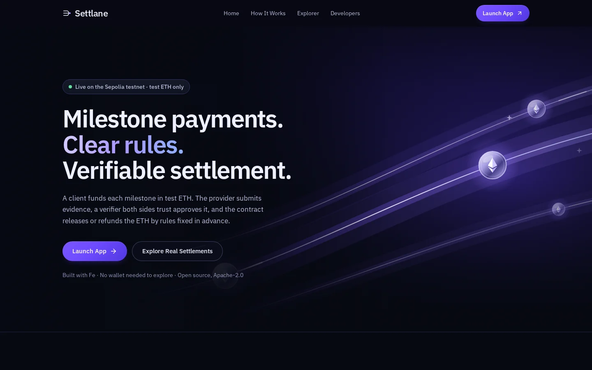
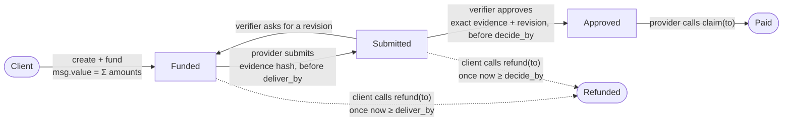
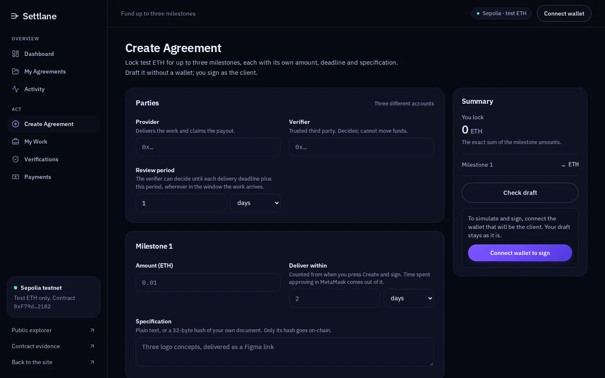
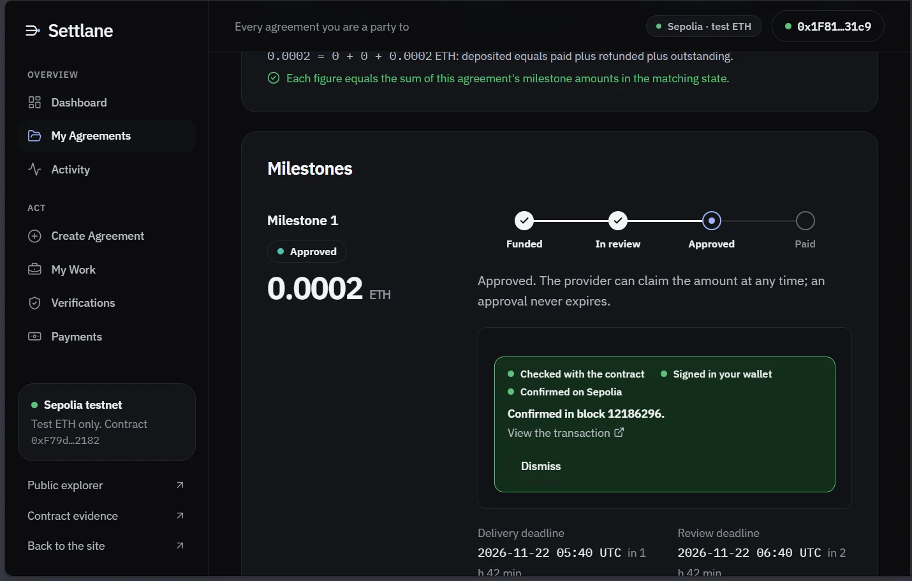
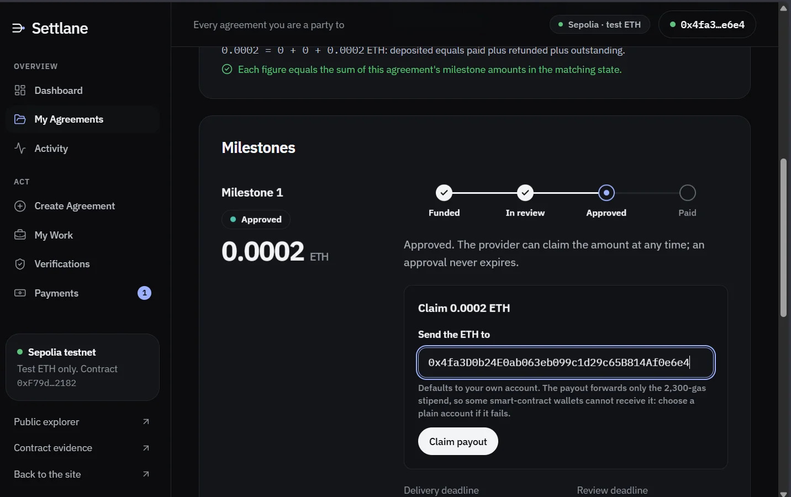
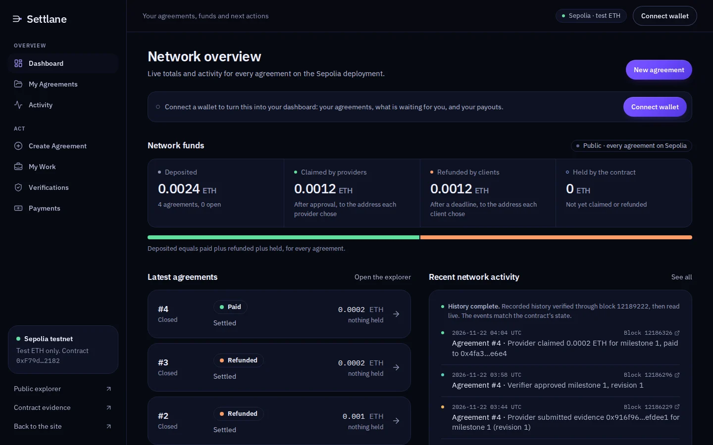
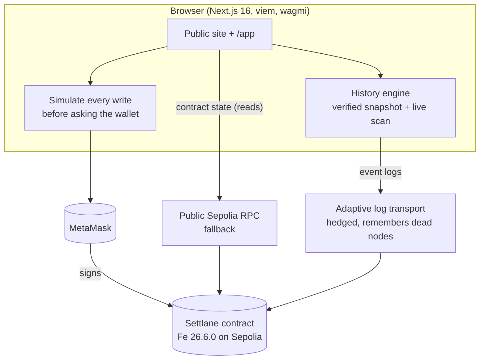
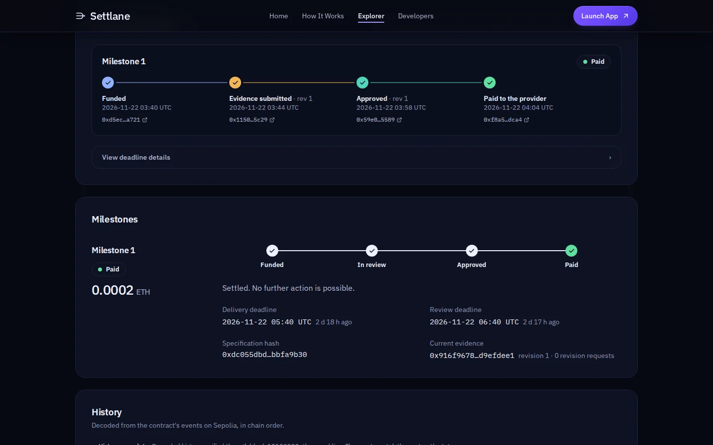
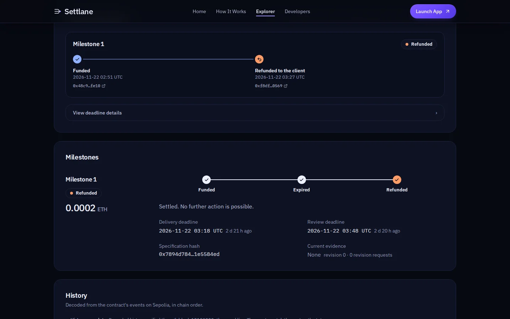

<div align="center">

# Settlane

**Agree first. Settle on-chain.**

Milestone escrow written in [Fe](https://fe-lang.org). A client funds every milestone up front, a provider submits evidence, a verifier both sides trust approves it, and the contract releases or refunds each milestone by rules fixed before the work begins.

[**Live app**](https://settlane.vercel.app) · [**Contract on Sepolia**](https://sepolia.etherscan.io/address/0xf79d229a039bf5c84ecc7327060f8bbc888d2182) · [**5‑minute judge walkthrough**](docs/EVIDENCE.md#a-five-minute-walkthrough-no-wallet-needed) · [**Why Fe**](docs/WHY_FE.md) · [**Testing**](docs/TESTING.md)



<sub>Unaudited prototype on the Ethereum Sepolia testnet. Test ETH only. The verifier is a trusted party.</sub>

</div>

---

## The problem

Paying for work means one side goes first. The client risks paying for work that never arrives. The provider risks delivering work that is never paid for.

It is a common, measured problem:

- **85%** of freelancers have their invoices paid late at least some of the time ([Remote, *Contractor Management Report 2025*](https://remote.com/blog/contractor-management/reversing-late-payment-culture)).
- Late payments are estimated to cost the UK economy **almost £11bn per year** ([UK Department for Business and Trade, 2025](https://www.gov.uk/government/publications/late-payments-research-impact-on-the-uk-economy)).

Milestone escrow is the established answer: money is set aside before work starts and released in stages. Freelance marketplaces such as Upwork hold fixed-price milestone funds in escrow and release them on client approval. On-chain, projects such as Kleros Escrow pair escrow with decentralised arbitration. Settlane does not invent escrow. It is a compact, fully tested implementation of the core mechanism, written in Fe, where every rule is public and every settlement can be checked on Sepolia by anyone.

## How it works



Each agreement has one to three milestones, settled independently. Approval and payment are separate actions: an approval never expires, and the provider claims when ready. A refund is never automatic: once a deadline passes without the required step, the milestone becomes refundable and the client must call `refund`. An approved milestone can never be refunded, and a milestone is paid or refunded, never both.

The full rule table, with every guard and revert reason, is in [`docs/LIFECYCLE.md`](docs/LIFECYCLE.md).

<table>
<tr>
<td width="50%"><br><sub><b>Create.</b> The client names the provider and verifier, sets each milestone's amount and deadline, and funds it in one transaction.</sub></td>
<td width="50%"><br><sub><b>Verify.</b> The verifier approves the exact evidence and revision. Real approval of agreement #4, confirmed in block 12186296.</sub></td>
</tr>
<tr>
<td width="50%"><br><sub><b>Claim.</b> The provider chooses the payee and claims. No further approval from the client is needed.</sub></td>
<td width="50%"><br><sub><b>Track.</b> Totals, agreements and every event are read from the contract, with no wallet needed.</sub></td>
</tr>
</table>

## Why Fe

Settlane's contract is short, and its most important property is that **moving money is a declared, visible capability**. Fe made three design decisions possible that matter for an escrow. Each is backed by source and tests in [`docs/WHY_FE.md`](docs/WHY_FE.md).

**1. Only two entry points can send ETH, and the effect list says so.** Every message arm declares the effects and storage it may touch with `uses`. Only `Claim` and `Refund` list `mut call`, the capability that sends value:

```fe
// ingots/settlane/src/settlane.fe
Submit { id, m, evidence } uses (ctx, mut log, agreements, mut milestones) { … }

Claim { id, m, to } -> Wei uses (
    ctx, mut call, mut log, mut totals, mut agreements, mut milestones,
) {
    handlers::claim_handler(id, m, to)
}
```

`Submit` cannot reach the totals or send ETH: the compiler rejects a handler that uses an effect it did not declare.

**2. Time is an effect, so every deadline is tested on both sides of the line.** Rules take `now` as an argument. The production contract supplies it from the block, and nothing else:

```fe
with (Clock = Clock { now: ctx.timestamp() }) {
    handlers::submit_handler(id, m, evidence)
}
```

A test-only contract in a separate ingot (`SettlaneTestClock`) serves the same messages through the same handlers but supplies `Clock` from a settable field. Tests can therefore run a refund at `deliver_by − 1`, `deliver_by` and `deliver_by + 1` against real contract code. The test contract can never ship: the workspace builds only the production ingot.

**3. A standard Ethereum interface.** Every selector is declared with `sol("…")`, so MetaMask, Etherscan and viem decode Settlane like any Solidity contract. A policy lint locks the ABI, including output types and order.

**What we found, and closed.** In Fe 26.6.0 an arm that lists `call` *read-only* can still send ETH: the compiler enforces omission of an effect, not its mutability, at the contract-arm level. We reproduced this ([`docs/FE_NOTES.md`, E7](docs/FE_NOTES.md#e7-investigation-2026-11-17-fe-2660-5b3f96a)) and closed it with a policy lint (only `Claim` and `Refund` may mention `call`) and a test proving that every non-payout transition leaves the contract balance unchanged. We also recorded a Fe 26.6.0 backend panic with a minimal reproduction (b6). Both findings are written up for other Fe builders.

## Architecture



| Layer | What it does | Where |
| --- | --- | --- |
| Rules | Pure functions: one ordered check per action, plus the time predicates. No effects. | [`rules.fe`](ingots/settlane/src/rules.fe) |
| Handlers | Check every rule, then write state, then (Claim/Refund only) send ETH as the last statement. | [`handlers.fe`](ingots/settlane/src/handlers.fe) |
| Contract | The ABI and the arms; each arm supplies the clock and calls its handler. | [`settlane.fe`](ingots/settlane/src/settlane.fe) |
| Test shell | Same messages and handlers under a settable clock, never built for production. | [`settlane-dev/`](ingots/settlane-dev/src/lib.fe) |
| Application | Explorer, agreement pages, and a wallet app for all six actions. | [`frontend/`](frontend/) |

Deeper design notes: [`docs/ARCHITECTURE.md`](docs/ARCHITECTURE.md). Every design decision with its reason: [`docs/DECISIONS.md`](docs/DECISIONS.md).

## Security model

The contract enforces the settlement rules. It does not judge the work: **the verifier is a trusted, designated party**, and an evidence hash proves only what was submitted, not its quality.

Within that model, the contract maintains thirteen invariants ([`docs/SECURITY.md`](docs/SECURITY.md)), including:

- **Conservation:** for every agreement, `deposited == paid + refunded + outstanding` after every transition.
- **Exclusive settlement:** a milestone ends `Paid` or `Refunded`, never both, and a second claim or refund reverts.
- **Authorization:** only the provider submits and claims, only the verifier reviews, only the client refunds.
- **Stale-review protection:** an approval names the exact evidence and revision, so a decision about an older submission cannot land.
- **Checks, effects, interaction:** every write happens before the single, stipend-only transfer, which is asserted. Reentrant attackers are tested as provider and as client.
- **Solvency:** `balance >= totalOutstanding`. No owner, admin or upgrade path exists.

## Real settlements on Sepolia

The production build is deployed at [`0xf79d229a039bf5c84ecc7327060f8bbc888d2182`](https://sepolia.etherscan.io/address/0xf79d229a039bf5c84ecc7327060f8bbc888d2182) (chain 11155111). Its runtime bytecode is byte-identical to a clean `fe build` with Fe 26.6.0. Four agreements have settled, each way, twice:

| Agreement | Outcome | Path | Transactions |
| --- | --- | --- | --- |
| [#1](https://settlane.vercel.app/agreements/1) | 0.001 ETH **paid** | fund → submit → approve → claim | [create](https://sepolia.etherscan.io/tx/0x661752e47fe7076b7f54f4bb33c6ec32bd0e1222e80f4d8c93e4131a55f470b3) · [submit](https://sepolia.etherscan.io/tx/0xe01e80607d67f72ae9374bde613afc0d3fcc1a25b5fc50dc6ee696e548f78c04) · [approve](https://sepolia.etherscan.io/tx/0x234075c6df23ba987c0fa68dc66e0d9652c68dd9bc45423d2da142034696fdf3) · [claim](https://sepolia.etherscan.io/tx/0xf1a40207a9f407f5f1d9994b213e4980dd6d8083593b9e68dd70734a60f771cc) |
| [#2](https://settlane.vercel.app/agreements/2) | 0.001 ETH **refunded** | fund → deadline passes → refund | [create](https://sepolia.etherscan.io/tx/0xdb4d4d75e2d2aa2d505696ced033032e74c322b175267cb41079b28e12c0c4f2) · [refund](https://sepolia.etherscan.io/tx/0xa9a25f2197a906340c285afb908959cc0952b6c1f2c019c23419a36862df398d) |
| [#3](https://settlane.vercel.app/agreements/3) | 0.0002 ETH **refunded** | through the app and MetaMask | [create](https://sepolia.etherscan.io/tx/0x48c9ddc9c628ff81079d554360ef99aa8c8388235365d7624322feae1b84fe10) · [refund](https://sepolia.etherscan.io/tx/0xf8dfb824accf25d64be41e7d688cb77631f0b87593da387a841b6347e1d90569) |
| [#4](https://settlane.vercel.app/agreements/4) | 0.0002 ETH **paid** | through the app and MetaMask | [create](https://sepolia.etherscan.io/tx/0xd5ec3e77ecfea1880f34b2d60dfe31d5ce4d23eee7d139d37c44218bc82fa721) · [submit](https://sepolia.etherscan.io/tx/0x115005cd0390e0b555441dfe6900453589a43e1bd8e562ace5a38be57df55c29) · [approve](https://sepolia.etherscan.io/tx/0x59e0470975aaa630b3f8d417bd1e32bf6c7332da01dc9bf21d43b2b1595b5589) · [claim](https://sepolia.etherscan.io/tx/0xf8a54e2aa7e155d3e0b130bb208665713a8c31e37e63dc396068adc83bd7dca4) |

Afterwards `totalOutstanding` is 0. Deployment transaction: [`0x4309d7c7…84598537`](https://sepolia.etherscan.io/tx/0x4309d7c7fc7b4f68820efe6da17d50381a822e1d656c607a31a58d4384598537), block 12175958.

<table>
<tr>
<td width="50%"></td>
<td width="50%"></td>
</tr>
</table>

Every step above is drawn from the contract's own events. The refunded agreement shows only what happened: no submission or approval is invented. [`docs/EVIDENCE.md`](docs/EVIDENCE.md) has a five-minute walkthrough that needs no wallet.

To check the deployment without trusting this app, rebuild and compare, then replay every event from a node (read-only, no key):

```sh
python3 experiments/sepolia/testnet.py artifact
python3 experiments/sepolia/verify_deployment.py --rpc-url https://ethereum-sepolia-rpc.publicnode.com \
  --address 0xf79d229a039bf5c84ecc7327060f8bbc888d2182 --from-block 12175958
```

## Testing

| Layer | Result | What it proves |
| --- | --- | --- |
| Fe contract tests | **90 passed** (43 production ingot, 47 test-clock ingot) | Authorization, every transition, deadline boundaries at d−1/d/d+1 in every slot, accounting, reentrancy, claim/refund exclusivity |
| Policy lint | passes; self-test 90 fixtures | Only `Claim`/`Refund` move ETH, one approved transfer form, production clock only, ABI locked |
| Local EVM (Anvil) | 52 checks + 8 wrong-clock mutations | The production bytecode under controlled block timestamps |
| Frontend unit | 254 passed, 2 opt-in live tests skipped | Lifecycle predicates, revert-reason coverage, history engine, wallet recovery rules |
| Browser, simulated wallet | 26 tests, 3 full repetitions, 78/78 runs | Create, submit, approve, revise, claim, refund, declined and lost wallet requests |
| Browser, read-only Sepolia | 34 tests (33 passed in a full run; the one failure, a missing screen-reader label, was fixed and re-tested) | Real agreements, accessibility (axe, WCAG 2.2 AA), 320–1440 px layouts |
| Browser, failure modes | hanging RPC 3/3, partial outage 2/2 | Honest degraded states, history recovers past dead nodes |
| Hosted CI | [green on `main`](https://github.com/osodotsol/settlane/actions) | Fe tests, Anvil, frontend and the release gate, Fe 26.6.0 pinned by SHA-256 |

Where each count was measured, and the exact commands: [`docs/TESTING.md`](docs/TESTING.md).

## Quick start

Requirements: **Fe 26.6.0** exactly (`fe --version` → `fe 26.6.0 (5b3f96a)`), Python 3, and for the app Node.js 22 with npm.

```sh
# contract
fe fmt --check ingots                        # format, both ingots
fe check && fe check ingots/settlane-dev     # type-check production and test ingots
python3 scripts/check_tests.py               # fe test for BOTH ingots (90 tests)
rm -rf out && fe build                       # production ingot only → out/Settlane.{bin,runtime.bin,abi.json}
python3 scripts/settlane_lint.py ingots --abi-dir out   # policy lint

# application (reads the live Sepolia deployment; no keys or env vars needed)
cd frontend
npm ci
npm run check                                # ABI sync, lint, typecheck, unit tests, production build
npm run dev                                  # http://localhost:3000
```

A bare `fe test` at the root runs only the production ingot. Use `scripts/check_tests.py`, which also fails if too few tests ran. Optional: `bash experiments/anvil/install_foundry.sh && python3 experiments/anvil/run.py --mutations` runs the production bytecode on a local chain. The app needs no environment variables. [`frontend/.env.example`](frontend/.env.example) lists the optional overrides.

## Limitations

- **Unaudited prototype, testnet only,** built with a pre-1.0 compiler. Passing tests does not make it secure.
- **The verifier is trusted.** It can approve or reject wrongly, but can never move funds or change parties. There is no dispute or appeal path; platforms such as Upwork and Kleros offer one, and Settlane does not.
- **Lost keys lock funds.** There is no admin or recovery path by design. An approved milestone whose provider loses its key stays locked.
- **Payouts forward only the 2,300-gas stipend.** Some smart-contract wallets cannot receive directly; the caller chooses the payee.
- **The client alone sets the terms** at creation; the provider does not sign them on-chain.
- **Evidence is a hash commitment.** The contract does not inspect the work.
- **The app relies on public Sepolia nodes.** It degrades to clearly labelled stale data when they fail.

Full list with reasons: [`docs/SECURITY.md`](docs/SECURITY.md).

## Declaration

- **Starting point:** the [Fe Builders Challenge starter repository](https://github.com/fe-lang/builders-challenge-starter) at commit [`f9d9aa9`](https://github.com/fe-lang/builders-challenge-starter/commit/f9d9aa92a03af82c2bbb0dc2e0810244eb13e686), whose example contract was replaced. Everything from 2026-11-18 onwards, inside the build window, is this project's work.
- **Third-party code:** none in the contract. The application uses open-source libraries (Next.js, React, viem, wagmi, TanStack Query, Tailwind CSS, lucide icons) under their own licenses, and self-hosts IBM Plex fonts (SIL OFL). Tools: Fe, Foundry (Anvil), Playwright, Python 3.
- **AI assistance:** built with AI coding assistants (Claude Code) under the owner's direction. The owner set the requirements, approved every specification decision ([`docs/DECISIONS.md`](docs/DECISIONS.md)) and signed every testnet transaction.

## License

[Apache-2.0](LICENSE).
